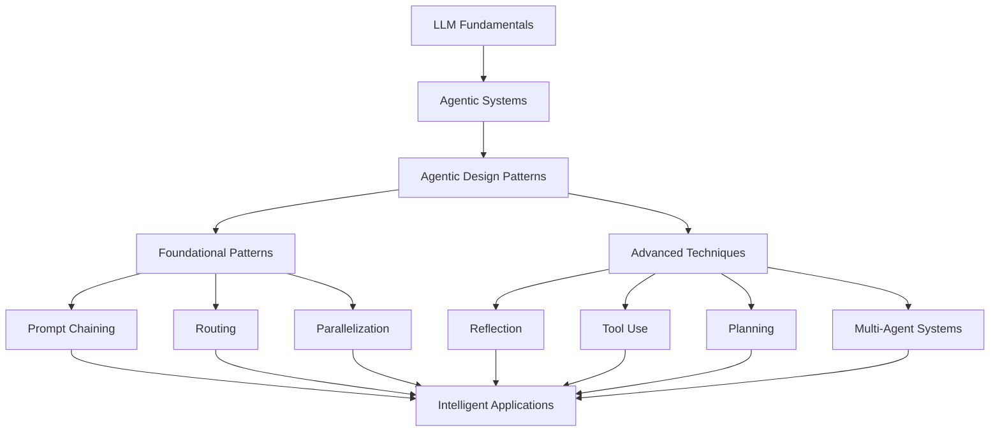

# Agentic Design Patterns: A Hands-On Guide to Building Intelligent Systems

**Course • Learning Path • Repository Structure • Getting Started • Contributing**

---

## Welcome!

Hello everyone! I'm **Asma Mestaysser**, and I'm happy to welcome you to *Agentic Design Patterns: A Hands-On Guide to Building Intelligent Systems*.

Today, we're starting a journey into the ideas and techniques behind AI agents. We'll explore how they work, how they make decisions, how they use tools, and how multiple agents can collaborate to solve complex problems.

Before jumping into code, we'll take some time to understand the concepts behind the systems we're building. Some lessons will be more conceptual than others, and that's intentional.

> The goal is not simply to make an agent run. It's to understand *why* it works, *how* it works, and *when* a particular design pattern is useful.

Throughout the course, we'll combine explanations, architectures, practical examples, and hands-on implementations. We'll look beneath the surface of the frameworks we use rather than treating them as collections of classes to import.

We'll take things step by step. Take your time, experiment with the examples, and revisit a concept whenever you need to.

Grab your coffee, open your favorite code editor, and let's get started!

**Welcome aboard, and happy learning!**

---

## 🧭 Course Overview

Modern AI systems are evolving beyond simple input-output interactions.

Large Language Models (LLMs) provide powerful capabilities for understanding and generating content. However, building systems that can reliably accomplish complex goals requires more than connecting an LLM to an API.

It requires **structure, orchestration, state management, decision-making**, and a thoughtful approach to how systems perceive, plan, act, and interact.

This is where **agentic design patterns** become useful.

> An **agentic design pattern** is a reusable approach to solving a recurring engineering problem when designing and implementing intelligent agents.

Just as software design patterns help developers structure applications, agentic patterns help engineers reason about agent behavior and system architecture.

### What will you learn?

This course explores **seven essential patterns**:

| Pattern | Description |
|---|---|
| **Prompt Chaining** | Decompose complex tasks into sequential steps. |
| **Routing** | Dynamically select the appropriate execution path. |
| **Parallelization** | Execute independent tasks concurrently. |
| **Reflection** | Evaluate and improve generated outputs. |
| **Tool Use** | Extend agent capabilities through external tools and services. |
| **Planning** | Organize actions to achieve a defined objective. |
| **Multi-Agent Systems** | Coordinate multiple agents to solve complex problems. |

By the end, you'll have a better understanding of how these patterns work individually, how they differ, and how they can be combined to build more capable systems.

---

## Course Structure

### Part One: Core Patterns

1. **Chapter 1:** Prompt Chaining - Sequential task decomposition
2. **Chapter 2:** Routing - Dynamic path selection
3. **Chapter 3:** Parallelization - Concurrent processing
4. **Chapter 4:** Reflection - Self-improvement mechanisms
5. **Chapter 5:** Tool Use - External capability integration
6. **Chapter 6:** Planning - Strategic task management
7. **Chapter 7:** Multi-Agent - Collaborative systems

### Part Two: Advanced Patterns

8. **Chapter 8:** Memory Management - State persistence
9. **Chapter 9:** Learning and Adaptation - Dynamic improvement
10. **Chapter 10:** Model Context Protocol (MCP) - Standardized interfaces
11. **Chapter 11:** Goal Setting and Monitoring - Objective tracking

### Part Three: Production Patterns

12. **Chapter 12:** Exception Handling and Recovery - Robust error management
13. **Chapter 13:** Human-in-the-Loop - Human-AI collaboration
14. **Chapter 14:** Knowledge Retrieval (RAG) - Information access patterns

### Part Four: Enterprise Patterns

15. **Chapter 15:** Inter-Agent Communication (A2A) - Agent networking
16. **Chapter 16:** Resource-Aware Optimization - Efficient resource usage
17. **Chapter 17:** Reasoning Techniques - Advanced decision-making
18. **Chapter 18:** Guardrails/Safety Patterns - Risk mitigation
19. **Chapter 19:** Evaluation and Monitoring - Performance tracking
20. **Chapter 20:** Prioritization - Task management
21. **Chapter 21:** Exploration and Discovery - Autonomous learning

### Appendices

- **Appendix A:** Advanced Prompting Techniques
- **Appendix B:** AI Agentic: From GUI to Real world environment
- **Appendix C:** Quick overview of Agentic Frameworks
- **Appendix D:** Building an Agent with AgentSpace
- **Appendix E:** AI Agents on the CLI
- **Appendix F:** Under the Hood: Reasoning Engines
- **Appendix G:** Coding agents

---

## 🎯 Learning Objectives

After completing the course, you should be able to:

- Understand the fundamental concepts behind agentic systems.
- Identify recurring problems in agent development.
- Explain the architecture and execution flow of each design pattern.
- Implement agentic workflows using Python.
- Understand the role of LLMs, tools, state, memory, and orchestration.
- Explore how frameworks implement common agentic abstractions.
- Evaluate when a pattern is appropriate and understand its limitations.
- Make better engineering decisions when designing intelligent systems.

> The emphasis is on **understanding the underlying mechanisms**—not simply learning framework APIs.

---

## 🗺️ Learning Path

The course contains **seven chapters** and **seven corresponding GitHub notebooks**.

We move from foundational workflow patterns toward more advanced reasoning, execution, and collaboration mechanisms.

### Part I — Foundational Patterns

#### Chapter 01 — Prompt Chaining

*Sequential task decomposition*

Learn how to divide a complex task into smaller steps, where the output of one operation becomes the input of the next.

Topics include:
- Sequential LLM calls
- Task decomposition
- Structured outputs
- Context engineering
- Reliability and validation
- Practical workflow architectures

**Notebook:** `01-prompt-chaining.ipynb`

### Part II — Advanced Techniques

#### Chapter 04 — Reflection

*Self-improvement mechanisms*

Explore how an agent can evaluate its own outputs, identify weaknesses, and iteratively improve its results.

**Notebook:** `04-reflection.ipynb`

#### Chapter 05 — Tool Use

Learn how agents interact with external tools, APIs, databases, and services to perform actions beyond text generation.

**Notebook:** `05-tool-use.ipynb`

#### Chapter 06 — Planning

Understand how agents organize actions, break objectives into subtasks, and adapt execution based on intermediate results.

**Notebook:** `06-planning.ipynb`

#### Chapter 07 — Multi-Agent Systems

*Collaborative systems*

Explore how multiple agents can communicate, coordinate responsibilities, delegate tasks, and collaborate toward a shared objective.

**Notebook:** `07-multi-agent.ipynb`

### Chapter Structure

Each chapter follows a consistent learning structure. The exact sections may vary depending on the pattern, but the general approach is:

| Section | Purpose |
|---|---|
| Conceptual Foundation | Understand the problem and the motivation behind the pattern. |
| Pattern Overview | Explore the core idea, characteristics, and execution flow. |
| Architecture | Understand how components interact and how information moves through the system. |
| Implementation | Build the pattern step by step using Python. |
| Framework Perspective | Explore relevant framework abstractions and implementations. |
| Practical Applications | Connect the pattern to realistic engineering scenarios. |
| Limitations | Understand trade-offs, failure cases, and design considerations. |
| Key Takeaways | Consolidate the most important concepts. |

Some chapters will spend more time on conceptual foundations, while others will focus more heavily on implementation. This is intentional: *understanding the problem is just as important as writing the solution.*

---

## 🧰 Technologies and Frameworks

The course uses **Python** and explores several tools and frameworks relevant to agent development.

### Core Language

Python is the primary implementation language for the practical examples and notebooks.

### Agent Development Frameworks

| Framework | Role in the Course | Official Documentation |
|---|---|---|
| **LangChain** | Components for connecting LLMs, tools, and workflows. | [Documentation](https://python.langchain.com/) |
| **LangGraph** | Stateful, graph-based workflow and agent orchestration. | [Documentation](https://langchain-ai.github.io/langgraph/) |
| **CrewAI** | Role-based agent and task orchestration. | [Documentation](https://docs.crewai.com/) |
| **Google ADK** | Framework for building, evaluating, and deploying agents. | [Documentation](https://google.github.io/adk-docs/) |

### Additional Technologies

Depending on the chapter and implementation, examples may also use:

- LLM provider APIs
- Pydantic and structured outputs
- HTTP clients and external APIs
- Async Python
- Environment variables and configuration management
- Testing and validation utilities

> **Important:** Frameworks are used as implementation references. The course focuses on understanding the underlying patterns rather than depending on a single framework.

---

## 🏛️ Repository Structure

The repository is organized to keep learning material, implementations, architectures, and visual resources separate.

```
agentic-design-patterns/
│
├── README.md
├── LICENSE
├── CONTRIBUTING.md
├── CODE_OF_CONDUCT.md
├── CITATION.cff
├── CHANGELOG.md
├── requirements.txt
│
├── docs/
│   ├── introduction.md
│   ├── learning-path.md
│   ├── prerequisites.md
│   ├── setup.md
│   └── glossary.md
│
├── chapters/
│   │
│   ├── 01-prompt-chaining/
│   │   ├── README.md
│   │   ├── lesson.md
│   │   ├── notebooks/
│   │   │   └── 01-prompt-chaining.ipynb
│   │   ├── architectures/
│   │   └── assets/
│   │
│   ├── 02-routing/
│   ├── 03-parallelization/
│   ├── 04-reflection/
│   ├── 05-tool-use/
│   ├── 06-planning/
│   └── 07-multi-agent/
│
├── assets/
│   ├── branding/
│   ├── images/
│   ├── gifs/
│   ├── icons/
│   └── diagrams/
│
├── examples/
│
└── resources/
    ├── references.md
    ├── further-reading.md
    └── useful-tools.md
```

### Directory Guide

| Directory | Description |
|---|---|
| `docs/` | General course documentation and learning guidance. |
| `chapters/` | The seven individual course chapters. |
| `notebooks/` | Practical, executable implementations. |
| `architectures/` | Pattern architecture diagrams and visual explanations. |
| `assets/` | Shared images, GIFs, icons, and branding resources. |
| `examples/` | Additional examples and experiments. |
| `resources/` | References, documentation, and further reading. |

Each chapter is designed to be understandable and navigable independently.

---

## 🚀 Getting Started

You can follow the course locally using Python and Jupyter notebooks.

### 1. Clone the Repository

```bash
git clone https://github.com/asmamest/agentic-design-patterns.git
cd agentic-design-patterns
```

### 2. Create a Virtual Environment

Python **3.11 or later** is recommended.

```bash
python -m venv .venv
```

Activate it:

**Windows**

```bash
.venv\Scripts\activate
```

**Linux / macOS**

```bash
source .venv/bin/activate
```

### 3. Install Dependencies

```bash
python -m pip install --upgrade pip
```

Install the course dependencies:

```bash
pip install -r requirements.txt
```

> Some chapters may have additional dependencies. Check the chapter documentation before running their notebooks.

### 4. Configure Environment Variables

Certain implementations require API credentials from an LLM provider.

Create a local `.env` file when required:

```env
OPENAI_API_KEY=your_api_key
ANTHROPIC_API_KEY=your_api_key
GOOGLE_API_KEY=your_api_key
```

Only configure the providers needed by the example you're running.

> **Security reminder:**
> - Never commit API keys or credentials.
> - Keep `.env` files local.
> - Use `.env.example` to document required variables without exposing secrets.

### 5. Start Jupyter

```bash
jupyter lab
```

Alternatively:

```bash
jupyter notebook
```

Navigate to the chapter you want to explore and open its notebook.

---

## 📓 How to Use the Notebooks

The notebooks are designed to complement the written lessons.

For the best learning experience:

1. Read the relevant chapter first.
2. Review the architecture and understand the execution flow.
3. Open the corresponding notebook.
4. Run the implementation step by step.
5. Modify prompts, parameters, tools, or components.
6. Observe how changes affect the behavior of the system.
7. Experiment with alternative implementations.

> **Don't just run the cells. Experiment with them.**

Try changing the inputs, introducing edge cases, simulating failures, and observing how the system responds.

The objective is to develop an **engineering understanding** of agentic systems.

---

## 🖼️ Visual Learning Resources

Architectures and visual explanations are an important part of this course.

They help make execution flows, component relationships, and system behavior easier to understand.

### Images

Shared course images are stored in:

```
assets/images/
```

### GIFs and Animations

Animated explanations and execution walkthroughs belong in:

```
assets/gifs/
```

### Architecture Diagrams

Chapter-specific architectures belong in:

```
chapters/<chapter-name>/architectures/
```

Shared diagrams belong in:

```
assets/diagrams/
```

### Framework and Tool Icons

Official or appropriately licensed framework and technology icons belong in:

```
assets/icons/
```

When adding an image or diagram:

- Use descriptive filenames.
- Prefer SVG for scalable diagrams and PNG or WebP for raster illustrations.
- Include meaningful alternative text.
- Keep visual assets close to the lesson they explain when they are chapter-specific.
- Document external image sources and licenses.
- Avoid unnecessarily large assets.

**Example:**

```markdown

```

---

## 🧠 Understanding the Architecture

The course explores different ways of organizing intelligent systems.

Rather than treating every agent as a single LLM call, we'll progressively examine the components and execution mechanisms that make more complex systems possible.

The following is a high-level conceptual map of the learning path:



> This diagram represents the **course progression**, not a universal execution architecture. Each pattern has its own architecture, trade-offs, and implementation details.

---

## ⚙️ Engineering Principles

Throughout the course, we'll pay attention to more than whether an agent produces a correct-looking answer.

We'll also explore engineering questions such as:

- **Reliability:** What happens when a model returns an unexpected result?
- **State management:** How does information persist across execution steps?
- **Validation:** How can outputs be checked before they are used?
- **Error handling:** How should failures and retries be managed?
- **Observability:** How can we understand what happened during execution?
- **Performance:** What are the latency and concurrency implications?
- **Cost:** How do model calls and external tools affect operating costs?
- **Security:** How should credentials, tool permissions, and untrusted inputs be handled?
- **Maintainability:** How can an agentic workflow remain understandable as it grows?

These considerations are essential when moving from demonstrations to real applications.

---

## 📚 Learning Resources

The course encourages consulting official documentation and technical resources alongside the implementations.

Useful starting points:

- [Anthropic — Building Effective Agents](https://www.anthropic.com/research/building-effective-agents)
- [LangChain Documentation](https://python.langchain.com/)
- [LangGraph Documentation](https://langchain-ai.github.io/langgraph/)
- [CrewAI Documentation](https://docs.crewai.com/)
- [Google Agent Development Kit](https://google.github.io/adk-docs/)

Additional references will be included in the relevant chapters.

---

## 🤝 Contributing

Learning is better when knowledge is shared.

If you find an issue, have an improvement suggestion, or want to contribute an implementation, you're welcome to participate.

Possible contributions include:

- Fixing errors or improving explanations.
- Improving an architecture diagram.
- Adding practical examples.
- Improving notebook clarity.
- Reporting broken links or dependencies.
- Suggesting additional experiments.
- Sharing alternative implementations.

Before contributing, please read `CONTRIBUTING.md`.

- For corrections, open an **issue**.
- For proposed changes, submit a **pull request** with a clear description of the improvement.

---

## 📜 License

This repository is intended to make agentic AI learning accessible.

The licensing model should distinguish between source code and educational content:

- **Code:** MIT License.
- **Written educational content, diagrams, and original visual materials:** Creative Commons Attribution-NonCommercial-ShareAlike 4.0 International (CC BY-NC-SA 4.0).

See the license files and attribution information for the applicable terms.

> The final repository should include the corresponding license texts before publication.

---

## 👩‍💻 About the Author

**Asma Mestaysser**

*Software Engineer | AI/ML Engineer | GenAI & Agentic AI*

This course is an independent educational project created to explore the engineering principles behind intelligent agents through explanations, architectures, and practical implementations.

- **GitHub:** [@asmamest](https://github.com/asmamest)
- **LinkedIn:** [Asma Mestaysser](https://www.linkedin.com/in/asmamestaysser/)
- **Substack:** [The Brief](https://substack.com/@asmamestaysser/note/p-224512156?r=1qvln7)

---

## ⭐ Support the Project

If you find this course useful:

- Give the repository a **star**.
- Share it with someone learning AI engineering.
- Open an **issue** if you find something that could be improved.
- Contribute examples or corrections.

Every contribution helps make the material better for the community.

---

> **Understand the patterns. Build the systems. Think like an AI engineer.**

*Made with curiosity and a lot of ❤ by Asma Mestaysser.*
